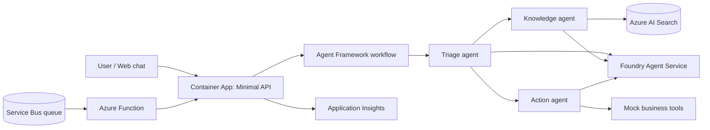

# Participant Guide: Build AI Solutions on Azure

Build one working solution across four days, individually, using C#, Microsoft Agent Framework, and managed Azure services.

## Your learning journey

| Day | Theme | Outcome |
|---|---|---|
| [1](day-1.md) | End-to-end agents + Azure AI Agent Service | A conversational agent that calls business tools |
| [2](day-2.md) | Advanced RAG | Policy answers grounded in retrieved documents, with citations |
| [3](day-3.md) | Multi-agent orchestration | Triage, knowledge, action, and escalation specialists |
| [4](day-4.md) | App Platform & Integration | An HTTP API, queue-triggered processing, and your final demo |

Agent concepts and Agent Service share Day 1 because the service runs the agent you build. Retrieval comes before orchestration so you can reuse your grounded agent as a specialist. Deployment comes last, when you have a complete solution to publish.

## Choose your scenario

Keep the same scenario throughout the event. All companies and records in your exercises must be fictitious.

| Scenario | Knowledge | Tools | Day 4 event |
|---|---|---|---|
| Customer support | Return, shipping, and warranty policies | Order lookup, return request, escalation | New support ticket |
| HR helpdesk | Leave, benefits, and travel policies | Leave balance, leave request, HR case | New employee case |
| Order processing | Pricing rules, SLAs, and catalog | Inventory check, order creation, review flag | New purchase order |

## Daily format

| Days | Learning | Individual build | Demo / wrap-up |
|---|---|---|---|
| 1-3 | 0:00-1:00 | 1:00-3:30 | 3:30-4:00 |
| 4 | 0:00-0:30 | 0:30-2:15 | 2:15-4:00: final showcase |

Day 4 reserves time for all 16 participants to present. Follow the daily agenda for breaks and milestones.

## Before you start

- Complete [setup.md](setup.md) and verify your Azure access.
- Use the starter kit shared in the event announcement. This repository contains guides only; the application files and commands shown in exercises refer to that separate kit.
- If you fall behind, use a published `day-N-start` checkpoint when available. Save your work on your own branch first; never discard uncommitted changes.
- For help, post your milestone, expected result, and a sanitized error message in the event chat. Do not post tokens, connection strings, or personal data.
- Use Copilot to explain errors, propose tests, and implement tools. Review generated code and be ready to explain your solution.

## Target solution

## Azure costs and cleanup

Allow approximately **USD 17-25 per participant for five days** as an indicative estimate, not a quote. Region, model usage, optional tools, connectors, and resource retention affect the total. AI Search is the largest expected fixed cost.

Set a **USD 50 budget alert**; alerts do not stop spending. Use only your workshop resources, check costs daily, and follow [teardown instructions](setup.md#5-teardown-end-of-day-4) after the event. Never delete resources outside your workshop environment.

## Assessment and showcase

Each Day 1-3 rubric scores functionality, use of technology, creativity, and demo quality from 1 to 5: maximum 20 per day.

For the final showcase, prepare **3 minutes of demo and 2 minutes of Q&A**:

1. Explain the problem and user.
2. Show a policy answer with a citation and an action with a specialist handoff.
3. Send a queue message and show its result.
4. Explain your architecture and one next improvement.

Have a backup recording ready in case the live demo fails.

| Final criterion | Maximum | Evidence |
|---|---|---|
| Functionality | 30 | End-to-end flow and one handled edge case |
| Use of technology | 30 | Agent Service, grounded RAG, orchestration, hosting/integration: up to 7.5 each |
| Creativity and business value | 20 | A useful scenario-specific improvement |
| Demo quality | 20 | Clear story, architecture explanation, timing, and Q&A |

Final score is the average showcase score out of 100 plus a progress bonus: each Day 1-3 total divided by 4, up to 15 bonus points overall. Functionality breaks ties. The Day 4 rubric is a readiness self-check, not an additional bonus.

Potential awards: Best Overall, Best RAG, Best Multi-Agent Design, Best Production-Readiness, and People's Choice.

## Safe building

Use synthetic data, least-privilege access, explicit approval before writes, bounded agent execution, and authenticated endpoints. Treat retrieved content as untrusted. A workshop pilot is not a production-ready service.
