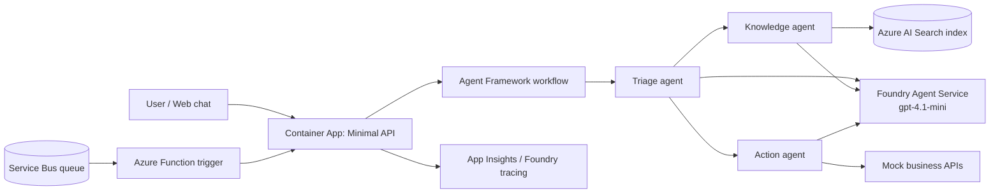

# Build AI Solutions on Azure: 4-Day Workshop + Hackathon

> **Planning blueprint, not a runnable starter kit.** All starter-code trees, datasets, scripts, checkpoint branches, and provisioning commands below describe assets facilitators still need to build and validate. See the [repository overview](../README.md#delivery-readiness) for delivery gates. Snippets and Azure cost estimates are illustrative.

A virtual, hands-on event. Each participant builds **one AI solution that grows each day**: a single agent, then a grounded agent, then a multi-agent system, and finally a deployed, event-driven service.

| Item | Detail |
|---|---|
| Audience | Developers and architects with beginner C# skills and no prior agent experience |
| Participants | 16 people, working individually |
| Format | Virtual, 4 days × 4 hours (1h learn, 2.5h hack, 0.5h demo/wrap-up). Day 4 uses a modified split; see the Day 4 note in [Agenda at a glance](#agenda-at-a-glance). |
| Stack | C# / .NET 9, Microsoft Agent Framework, Azure AI Foundry Agent Service, Azure AI Search, Azure Container Apps, Azure Service Bus, Azure Functions |
| Tools | VS Code, C# Dev Kit, GitHub Copilot, Azure CLI, Azure Developer CLI (`azd`) |
| Azure | One subscription per participant, provisioned by `azd up` before Day 1 |

## Files

| File | Contents |
|---|---|
| [setup.md](./setup.md) | Prerequisites checklist, pre-event setup, smoke test, teardown |
| [day-1.md](./day-1.md) | End-to-end agents on Foundry Agent Service |
| [day-2.md](./day-2.md) | Advanced RAG with Azure AI Search |
| [day-3.md](./day-3.md) | Multi-agent orchestration |
| [day-4.md](./day-4.md) | Azure App Platform & Integration, plus the final showcase |

## Covering 5 topics in 4 days

| Day | Theme | Topics covered | Why here |
|---|---|---|---|
| 1 | Your first end-to-end agent | **#1 Building E2E agents + #4 Azure AI Agent Service** | Agent Service is the managed runtime for an E2E agent. Teaching the concept (model + instructions + tools + memory) on the platform that hosts it avoids teaching the same thing twice and gets beginners to a working agent in the first hour. |
| 2 | Ground it in company knowledge | **#3 Advanced RAG** | An agent without knowledge makes things up. RAG is the most common enterprise need and is easiest to learn with one agent before adding orchestration. |
| 3 | Split it into a team | **#2 Multi-agent orchestration** | Orchestration only makes sense after participants have felt one agent get overloaded with tools and responsibilities. The Day 2 RAG agent becomes one specialist. |
| 4 | Ship it and integrate it | **#5 App Platform & Integration** | Hosting, events, and integration come last because participants now have something worth deploying. This day ends with the showcase. |

**Why not combine RAG + multi-agent?** Both are conceptually heavy for beginners. Agent Service and E2E agents overlap the most (same SDK, same portal, same concepts), so combining those two costs the least.

### Cumulative challenge vs. independent daily challenges

The challenges are **cumulative**: one solution grows across the four days, which produces a strong Day 4 showcase. The main risk is that a participant who falls behind on Day N is blocked on Day N+1. This is mitigated as follows:

- The starter repo has **checkpoint branches**: `day-1-start`, `day-2-start`, `day-3-start`, `day-4-start`. Each `day-N-start` branch contains a complete reference solution for the previous day.
- Anyone can run `git switch day-N-start` at the start of a day and continue from there.
- Each day's challenge also works on its own, so independent mode remains a fallback.

## Business scenarios (participant's choice)

Each participant picks **one** scenario on Day 1 and keeps it for all four days. The starter repo has data, policy documents, and mock tools for all three.

| Scenario | Users | Knowledge (Day 2) | Actions/tools | Event trigger (Day 4) |
|---|---|---|---|---|
| **Customer Support** (Contoso Outdoor e-commerce) | Shoppers | Return/shipping/warranty policies, product manuals | `GetOrderStatus`, `CreateReturn`, `EscalateToHuman` | New support email/ticket on queue |
| **HR Helpdesk** (Contoso HR) | Employees | Leave, benefits, travel, and expense policies | `GetLeaveBalance`, `SubmitLeaveRequest`, `OpenHrCase` | New HR case submitted |
| **Order Processing** (Contoso Wholesale) | B2B buyers / ops | Pricing rules, SLAs, product catalog | `CheckInventory`, `CreateOrder`, `FlagForReview` | Purchase order arrives on queue |

## Target architecture (end of Day 4)



## Starter repo layout (`ai-hack-starter`)

```text
ai-hack-starter/
├─ azure.yaml                  # azd project
├─ infra/                      # Bicep: Foundry, model deployments, AI Search, ACA, Service Bus, Functions, App Insights
├─ data/
│  ├─ customer-support/        # policies/*.md, orders.json
│  ├─ hr-helpdesk/             # policies/*.md, employees.json
│  └─ order-processing/        # policies/*.md, inventory.json
├─ src/
│  ├─ HackAgent.Console/       # Day 1–3 console host
│  ├─ HackAgent.Core/          # agents, tools, workflows (shared)
│  ├─ HackAgent.Ingest/        # Day 2 indexer/ingestion
│  ├─ HackAgent.Api/           # Day 4 Minimal API (Container App)
│  └─ HackAgent.Functions/     # Day 4 Service Bus trigger
├─ tests/HackAgent.Evals/      # small eval sets per scenario
├─ docs/                       # per-day challenge sheets (copies of day-N.md hackathon section)
└─ .github/copilot-instructions.md   # repo conventions for Copilot
```

Planned starter-kit branches: `day-1-start`, `day-2-start`, `day-3-start`, and `day-4-start`. Keep the full reference solution in a separate private facilitator repository until the event ends; branches in a public repository cannot be kept private.

## Agenda at a glance

| Day | 0:00–1:00 Learn | 1:00–3:30 Hack | 3:30–4:00 Demo / wrap |
|---|---|---|---|
| 1 | Agent fundamentals, Foundry Agent Service, tools, threads | Build a scenario agent with 2+ function tools | 3 volunteer demos + Q&A |
| 2 | RAG patterns: hybrid search, semantic ranking, query rewriting, agentic retrieval, evals | Ground the agent in the policy docs, with citations | 3 volunteer demos + Q&A |
| 3 | Orchestration patterns: sequential, concurrent, handoff, group chat | Triage → specialist multi-agent workflow | 3 volunteer demos + Q&A |
| 4* | *0:00–0:30* Hosting & integration | *0:30–2:15* Deploy + event trigger | *2:15–4:00* **Final showcase** |

\*Day 4 uses a different split so all 16 participants can demo (see [day-4.md](./day-4.md)). Each day has a 10-minute break inside the hack block.

## Facilitator notes

**Staffing (for 16 participants)**
- 1 lead presenter, who also serves as MC and timekeeper.
- 2 technical mentors (about 8 participants each), each with a dedicated breakout room.
- 1 Azure "floater" for quota, RBAC, and subscription issues. The lead can cover this role on Days 2–4.

**Running it virtually (Teams/Zoom)**
- Use the main room for the learning hour and demos, and two mentor breakout rooms during the hack. Participants can stay in the main room and get pulled into a breakout when they need help.
- Run a **help queue** in a chat channel with this format: `#help <name> <milestone> <error snippet>`. Mentors claim requests with an emoji.
- Do **traffic-light check-ins** at 45 and 90 minutes into the hack: 🟢 on track, 🟡 slow, 🔴 blocked. Point anyone who is 🔴 at the checkpoint branch after 15 minutes of being stuck.
- Show a visible timer and post the milestone list in chat at the start of the hack.
- Encourage Copilot use, and teach good prompts ("Explain this error", "Add a tool that…"). Each day's `.github/copilot-instructions.md` keeps suggestions consistent with the SDK versions pinned in the repo.

**Before the event**
- Run `azd up` in a clean subscription **T-7 days**. Confirm model quota (gpt-4.1-mini and text-embedding-3-small) in the chosen region.
- Hold a 30-minute **setup clinic** at T-3 days. Anyone whose smoke test fails gets a 1:1 slot.
- Pin all NuGet versions in `Directory.Packages.props`. The Agent Framework changes quickly, so freeze versions once rehearsal passes.
- Pre-record a 2-minute screen capture of each day's reference solution as a fallback demo.

**Each day**
- Fifteen minutes before start, check Azure status and run the smoke test in your own subscription.
- After the day, push the next `day-N-start` branch and post a 5-line recap in chat.

## Estimated Azure cost per participant

The estimate assumes resources live for about 5 days (setup day + 4 event days) in a US region with list prices. It includes typical hackathon usage: about 2–3M input tokens and 0.5M output tokens in total, and a few thousand embeddings.

| Service | SKU | Est. cost (5 days) |
|---|---|---|
| Azure AI Search | Basic (needed for semantic ranker and agentic retrieval) | ~$12–13 |
| Foundry models | gpt-4.1-mini (Global Standard), text-embedding-3-small | ~$2–5 |
| Foundry Agent Service | Model and tool charges depend on features used; optional tools can add cost | Allowance excludes optional paid tools |
| Azure Container Apps | Consumption; scale to zero | ~$0–1 |
| Service Bus | Basic | <$0.10 |
| Azure Functions | Flex Consumption | ~$0 |
| Storage, Log Analytics, App Insights | Pay-as-you-go | ~$1–2 |
| Container Registry | Basic | ~$1 |
| **Total** | | **≈ $17–25 per participant** |

**Recommendation:** set a **$50 budget alert** per subscription. Have participants run `azd down --purge` at the end of Day 4. The single biggest cost is AI Search Basic, so don't create it earlier than T-2 days. Prices change, so confirm them with the [Azure pricing calculator](https://azure.microsoft.com/pricing/calculator/).

## Final showcase format and scoring (Day 4)

**Format (105 min):** 16 demos × 5 min (3 min live demo + 2 min judge Q&A) = 80 min. Add 10 min for judges to deliberate and 15 min for awards and closing.

- Run demos in order of a randomized list posted the evening before.
- Each demo must show: (1) the scenario and the problem, (2) a live query answered with citations, (3) a multi-agent handoff, (4) the event-triggered or deployed path, (5) one "what I'd do next".
- A participant whose live demo fails switches immediately to a backup screen recording, with no penalty beyond the demo-quality score.
- Judges: 3 people (for example the lead facilitator, a mentor, and a business stakeholder).

**Scoring (100 points)**

| Criterion | Weight | What judges look for |
|---|---|---|
| Functionality | 30 | End-to-end flow works: ask → retrieve → act → respond; handles at least one edge case |
| Use of the event's tech | 30 | Correct use of Agent Service, RAG (hybrid + semantic + citations), multi-agent workflow, and hosting/integration. Each layer is worth up to 7.5 points. |
| Creativity & business value | 20 | Realistic scenario twist, a useful extra tool, a good UX, and a clear statement of value |
| Demo quality | 20 | Clear story, stays within time, explains the architecture, handles Q&A |

**Final score** = average of the judges' scores (max 100) + **daily progress bonus** (max +15). The bonus is each Day 1–3 rubric total (max 20) divided by 4, so each day is worth up to +5. Break ties on the Functionality score.

**Awards:** 🏆 Best Overall · 🧠 Best RAG · 🤝 Best Multi-Agent Design · 🚀 Best Production-Readiness · 💡 People's Choice (participant vote in chat)

## Out of scope

Fine-tuning, front-end frameworks (a simple HTML chat page is planned), full production hardening, and Python content. Baseline authentication, authorization, synthetic data, and approval before writes remain required for any public deployment.
