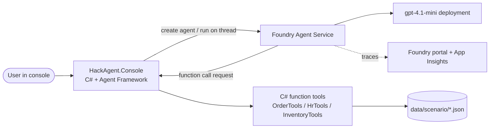

# Day 1: Your First End-to-End Agent

> **Blueprint:** starter files and checkpoints are proposed facilitator assets. Snippets are illustrative and must be adapted to pinned, tested SDK versions. Use synthetic data and require explicit approval before any write tool.

**Topics:** #1 Building end-to-end AI agents + #4 Azure AI Agent Service (Foundry Agent Service)

## Learning objectives
By the end of the day, participants can:
1. Explain what makes an **agent** (model + instructions + tools + memory/threads + a loop) and how it differs from a chatbot.
2. Create and run an agent on **Foundry Agent Service** from C# using the **Microsoft Agent Framework**.
3. Add **function tools** (C# methods) and a built-in tool (**Code Interpreter**).
4. Keep conversation state with **threads**, and inspect runs and traces in the Foundry portal.
5. Write good agent instructions (role, scope, tone, when to use which tool, refusal rules).

## Agenda

| Time | Block | Content |
|---|---|---|
| 0:00–0:10 | Welcome | Event goals, the cumulative build, scenario choice, help-queue rules |
| 0:10–0:25 | Concept | What is an agent? The agent loop (reason → call tool → observe → respond). Agent vs. RAG vs. workflow. |
| 0:25–0:40 | Concept | Foundry Agent Service: projects, agents, threads, runs, tools, managed identity, tracing. Where Agent Framework fits (a C# abstraction over many agent providers). |
| 0:40–0:55 | Live demo | From an empty console app to an agent with one function tool. Show the run steps in the Foundry portal. |
| 0:55–1:00 | Briefing | Challenge walk-through and milestones |
| 1:00–3:30 | **Hackathon** | M1–M4 + stretch goals (traffic-light check-ins at 1:45 and 2:30; 10-min break around 2:10) |
| 3:30–3:50 | Demos | 3 volunteers × 5 min |
| 3:50–4:00 | Wrap | Recap, preview of Day 2, push `day-2-start` |

## Real-world use cases

| Use case | What the agent does | Business value |
|---|---|---|
| **Retail order-status agent** (e.g., an e-commerce support desk) | Looks up orders, explains delays, starts returns using back-office APIs | Deflects 30–50% of "where is my order?" contacts. Available 24/7. Human agents focus on complex cases. |
| **IT/HR self-service agent** (e.g., an internal employee portal) | Checks leave balances, files tickets, resets access through workflows | Faster answers for employees. Fewer Tier-1 tickets. Consistent policy application, with an audit trail of every tool call. |

## Hackathon challenge: "Tier-1 Agent"

### Problem statement
Your company (scenario of your choice) gets a flood of repetitive requests. Build a **Tier-1 agent** in a C# console app that:
- answers in your company's voice and stays in scope,
- calls **at least two function tools** against the mock data in `data/<scenario>/`,
- remembers context within a conversation (thread),
- escalates (calls `EscalateToHuman` / `OpenHrCase` / `FlagForReview`) when it can't help.

### Architecture



### Azure services & SDKs

| Area | Service / package |
|---|---|
| Agent runtime | Azure AI Foundry Agent Service (Foundry project, `gpt-4.1-mini`) |
| Agent SDK | `Microsoft.Agents.AI`, `Microsoft.Agents.AI.Foundry` |
| Tool definitions | `Microsoft.Extensions.AI` (`AIFunctionFactory.Create`) |
| Auth | `Azure.Identity` (`DefaultAzureCredential`) |
| Observability | `Azure.Monitor.OpenTelemetry.Exporter`, Foundry tracing |

### Milestones

| # | Milestone | Done when… | Suggested time |
|---|---|---|---|
| M1 | **Hello agent.** Pick a scenario, set `SCENARIO` in `.env`, run the starter, and create an agent with your own instructions. | The agent answers "What can you help me with?" in scope. | 25 min |
| M2 | **First tool.** Implement one read tool (e.g., `GetOrderStatus(orderId)`), register it, and ask a question that triggers it. | The console log shows the tool call and the answer uses real mock data. | 40 min |
| M3 | **Action + escalation.** Add a write tool (`CreateReturn` / `SubmitLeaveRequest` / `CreateOrder`) and an escalation tool. Update the instructions with rules for when to escalate. | A multi-turn chat completes an action, and an out-of-scope request escalates. | 45 min |
| M4 | **Observe.** Enable tracing, then find your run steps in the Foundry portal (Tracing / Threads). | Screenshot of a trace showing the tool calls. | 20 min |

### Stretch goals
- Add the built-in **Code Interpreter** tool (e.g., "chart my last 5 orders" or "plot leave taken by month").
- **Streaming** responses (`RunStreamingAsync`) for a better UX.
- **Guardrails**: refuse PII requests, and add a confirmation step ("Shall I submit this? y/n") before write tools run.
- Write 5 test prompts in `tests/HackAgent.Evals/day1.jsonl` and run them in a batch.

## Starter code outline

```text
src/HackAgent.Core/
├─ Config/HackSettings.cs           # reads .env (endpoint, deployment, scenario)
├─ Agents/Tier1AgentFactory.cs      # TODO: create the agent with instructions + tools
├─ Agents/Instructions/
│  ├─ customer-support.md           # starter system prompts (edit these)
│  ├─ hr-helpdesk.md
│  └─ order-processing.md
├─ Tools/
│  ├─ OrderTools.cs                 # GetOrderStatus implemented; CreateReturn = TODO
│  ├─ HrTools.cs                    # GetLeaveBalance implemented; SubmitLeaveRequest = TODO
│  ├─ InventoryTools.cs             # CheckInventory implemented; CreateOrder = TODO
│  └─ EscalationTools.cs            # TODO
└─ Telemetry/Tracing.cs             # OpenTelemetry setup (done)
src/HackAgent.Console/Program.cs    # chat loop (done) + --smoke-test
```

Key code shape (illustrative). Method names follow the pinned Agent Framework version, so check `docs/sdk-cheatsheet.md` in the repo.

```csharp
// Tools: plain C# methods with descriptions become function tools
public sealed class OrderTools(IOrderRepository repo)
{
    [Description("Get shipping status for an order by its ID, e.g. 'ORD-1001'.")]
    public string GetOrderStatus([Description("Order ID")] string orderId)
        => repo.Find(orderId)?.ToStatusText() ?? $"No order found with ID {orderId}.";
}

// Agent: created on Foundry Agent Service, invoked through Agent Framework
var credential = new DefaultAzureCredential();
AIAgent agent = await Tier1AgentFactory.CreateAsync(
    settings.ProjectEndpoint, settings.ModelDeployment, credential,
    name: "tier1-" + settings.Scenario,
    instructions: File.ReadAllText($"Agents/Instructions/{settings.Scenario}.md"),
    tools: [ AIFunctionFactory.Create(orderTools.GetOrderStatus),
             AIFunctionFactory.Create(orderTools.CreateReturn) ]);

var thread = agent.GetNewThread();            // conversation memory
while (Console.ReadLine() is { Length: > 0 } input)
    Console.WriteLine(await agent.RunAsync(input, thread));
```

## Rubric (score each 1–5; max 20)

| Criterion | 1 – Beginning | 3 – Solid | 5 – Excellent |
|---|---|---|---|
| Functionality | The agent runs but tools fail or aren't called | 2+ tools work; multi-turn context works | All milestones done; handles bad input (unknown IDs, missing info) gracefully |
| Use of the day's tech | Hard-coded answers; no Agent Service | Agent on Foundry with function tools and threads | Plus tracing, streaming, or Code Interpreter used meaningfully |
| Creativity | Starter instructions unchanged | A distinct persona and scenario rules | A clever extra tool or a thoughtful confirmation/guardrail UX |
| Demo quality | Hard to follow | Shows a working multi-turn chat with a tool call | Clear story, shows the trace, explains the agent loop |

## Prerequisites
- [setup.md](./setup.md) smoke test passed
- Can run `dotnet run` and edit C# classes
- A scenario chosen (Customer Support, HR Helpdesk, or Order Processing)

## Common pitfalls

| Pitfall | Fix |
|---|---|
| The agent never calls the tool | Make the tool `[Description]` specific. In the instructions, say *when* to use it ("Always call GetOrderStatus when the user mentions an order ID"). |
| A new agent is created on every run, cluttering the portal | Reuse the agent by name/ID (the starter caches the ID in `.agent-id`), or delete it on exit. |
| `PermissionDenied` on the project | The *Azure AI User* role is missing or hasn't propagated. Re-login and check the tenant. |
| Tool throws → the run hangs or errors | Handle expected errors with typed failure results; log unexpected errors with a correlation ID and surface a sanitized failure. Never report an unsuccessful action as successful. |
| The model invents order IDs | Add "Never invent IDs or data; if missing, ask the user" to the instructions. |
| Context lost between turns | Reuse the same `thread` object instead of creating one per message. |
