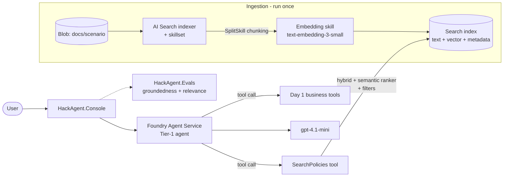

# Day 2: Grounding the Agent with Advanced RAG

> Use the separate starter kit shared for this event; the files and datasets below are not included in this documentation repository. SDK snippets are illustrative. Treat retrieved documents as untrusted input, enforce authorization outside the model, and never allow model-selected filters to grant access.

**Topic:** #3 Advanced RAG patterns

## Learning objectives
By the end of the day, participants can:
1. Explain the RAG pipeline (ingest → chunk → embed → index → retrieve → rerank → generate with citations) and where naive RAG fails.
2. Build an Azure AI Search index with **integrated vectorization** (chunking + embeddings handled by the indexer).
3. Use **hybrid search** (keyword + vector) with the **semantic ranker**, and compare quality against vector-only search.
4. Apply advanced patterns: **query rewriting**, **metadata filters**, **agentic retrieval** (multi-query planning), and **citations**.
5. Measure answer quality with a small **groundedness/relevance eval**.

## Agenda

| Time | Block | Content |
|---|---|---|
| 0:00–0:05 | Recap | Day 1 highlights; `git switch day-2-start` if needed |
| 0:05–0:20 | Concept | Why RAG? Failure modes of naive RAG: bad chunks, keyword misses, lost context, no citations, stale data. |
| 0:20–0:35 | Concept | Advanced patterns: chunking strategies, hybrid + RRF, semantic reranking, query rewriting/decomposition, filters, agentic retrieval, eval loop. |
| 0:35–0:55 | Live demo | Index the policies with integrated vectorization. Compare vector-only vs. hybrid + semantic results in Search Explorer. Wire search into the agent as a tool. |
| 0:55–1:00 | Briefing | Challenge and milestones |
| 1:00–3:30 | **Hackathon** | M1–M4 + stretch goals (check-ins at 1:45 and 2:30; break around 2:10) |
| 3:30–3:50 | Demos | 3 volunteers × 5 min (show a cited answer and a before/after quality comparison) |
| 3:50–4:00 | Wrap | Recap, preview of Day 3 |

## Real-world use cases

| Use case | What RAG does | Business value |
|---|---|---|
| **Policy & benefits assistant** (HR, insurance, banking) | Answers from hundreds of policy PDFs, with citations to the exact clause | Fewer compliance errors; staff trust answers they can verify; HR/ops time spent on repetitive questions drops |
| **Field-service / product-support copilot** (manufacturing, retail) | Searches manuals, troubleshooting guides, and past tickets with filters (product, model, version) | Higher first-time fix rate, faster technician onboarding, less tribal knowledge locked in experts |

## Hackathon challenge: "Grounded Agent"

### Problem statement
Your Day 1 agent answers from model knowledge, which is risky. Ground it in your company's **policy documents** (`data/<scenario>/policies/*.md`, about 15 docs each, including some deliberately tricky ones with near-duplicate and outdated versions). The agent must:
- answer policy questions **only** from retrieved content, **with citations** (`[source: returns-policy.md#refunds]`),
- say "I don't know" when the docs don't cover the question,
- still use its Day 1 tools for actions (e.g., "Can I return order ORD-1001?" needs **both** policy and order data).

### Architecture



### Azure services & SDKs

| Area | Service / package |
|---|---|
| Retrieval | Azure AI Search (Basic): index, indexer, skillset, semantic ranker, vectorizer |
| Embeddings | Foundry deployment `text-embedding-3-small` |
| Source docs | Azure Blob Storage (`Azure.Storage.Blobs`) |
| Search SDK | `Azure.Search.Documents` |
| Agent | `Microsoft.Agents.AI`, `Microsoft.Agents.AI.Foundry` (from Day 1) |
| Evaluation | `Microsoft.Extensions.AI.Evaluation.Quality` (groundedness, relevance, coherence) |

### Milestones

| # | Milestone | Done when… | Suggested time |
|---|---|---|---|
| M1 | **Ingest.** Run `HackAgent.Ingest` to upload docs and create the data source, index, skillset (chunk 512 tokens / 64 overlap + embeddings), and indexer. | The index shows about 100+ chunks, each with a `title`, `source`, `category`, and vector. | 30 min |
| M2 | **Hybrid + semantic.** Implement `SearchPolicies(query, category?)` with a hybrid query, `QueryType.Semantic`, top 5, and a `category` filter. Return chunks as `[source] text`. | In Search Explorer and in code, hybrid + semantic beats vector-only on the 3 "tricky" questions in `docs/day2-tricky.md`. | 40 min |
| M3 | **Grounded agent with citations.** Register `SearchPolicies` as a tool. Update the instructions with: cite sources, say "I don't know" when there is no evidence, and prefer the newest policy version (the `effectiveDate` field). | Answers include citations; an out-of-scope question gets "I don't know"; a mixed policy + order question uses both tools. | 45 min |
| M4 | **Evaluate.** Run `HackAgent.Evals` on the 10 Q&A pairs in `tests/.../day2.jsonl`. | Groundedness and relevance scores are printed; average groundedness ≥ 4/5. | 25 min |

### Stretch goals
- **Query rewriting:** have the model rewrite conversational follow-ups ("what about electronics?") into standalone search queries before retrieval.
- **Agentic retrieval:** create an AI Search *knowledge base / knowledge agent* that plans sub-queries in parallel, and compare it with your M2 tool.
- Compare with Agent Service's **built-in Azure AI Search tool** (no custom code). Discuss the trade-offs: control vs. simplicity.
- **Security trimming:** add an `audience` field (e.g., `employee` vs. `manager`) and filter by it.
- Add a **freshness** rule: when two chunks conflict, the one with the newer `effectiveDate` wins.

## Starter code outline

```text
src/HackAgent.Ingest/
├─ Program.cs                    # upload → create index/skillset/indexer → run (scaffolded)
├─ IndexDefinition.cs            # TODO: fields (id, title, source, category, effectiveDate, content, contentVector), vectorizer, semantic config
└─ SkillsetDefinition.cs         # SplitSkill + AzureOpenAIEmbeddingSkill (provided)
src/HackAgent.Core/
├─ Tools/SearchTools.cs          # TODO: SearchPolicies (hybrid + semantic + filter)
├─ Tools/QueryRewriter.cs        # stretch
└─ Agents/Instructions/*.md      # TODO: add grounding + citation rules
tests/HackAgent.Evals/
├─ day2.jsonl                    # 10 question / expected-answer pairs per scenario
└─ EvalRunner.cs                 # groundedness + relevance evaluators (provided)
```

Key code shape (illustrative):

```csharp
[Description("Search company policy documents. Use for any policy, rule, or eligibility question.")]
public async Task<string> SearchPolicies(
    [Description("Standalone search query")] string query,
    [Description("Optional category filter, e.g. 'returns'")] string? category = null)
{
    var options = new SearchOptions
    {
        Size = 5,
        QueryType = SearchQueryType.Semantic,
        SemanticSearch = new() { SemanticConfigurationName = "default" },
        VectorSearch = new() { Queries = { new VectorizableTextQuery(query)
            { KNearestNeighborsCount = 30, Fields = { "contentVector" } } } },
        Filter = category is null ? null : SearchFilter.Create($"category eq {category}"),
        Select = { "title", "source", "content", "effectiveDate" }
    };
    var results = await _search.SearchAsync<PolicyChunk>(query, options); // text + vector = hybrid
    // TODO: format each hit as "[source] content" for citations
}
```

## Rubric (score each 1–5; max 20)

| Criterion | 1 – Beginning | 3 – Solid | 5 – Excellent |
|---|---|---|---|
| Functionality | Index built but the agent doesn't use it | Agent answers policy questions with citations and refuses unknowns | Mixed policy + action questions work; handles outdated/conflicting docs |
| Use of the day's tech | Vector-only or keyword-only search | Hybrid + semantic ranker + filters + eval run | Plus query rewriting or agentic retrieval, with a measured improvement |
| Creativity | Default docs and prompts | Scenario-specific grounding rules | A novel pattern (security trimming, freshness rule, a "show sources" UX) |
| Demo quality | Shows an answer only | Shows a cited answer and the "I don't know" case | Shows before/after eval scores and explains why they improved |

## Prerequisites
- Day 1 M3 complete, or `git switch day-2-start`
- AI Search and Storage provisioned (`azd up` from setup); *Search Index Data Contributor* and *Search Service Contributor* roles assigned

## Common pitfalls

| Pitfall | Fix |
|---|---|
| Indexer succeeds but the vector field is empty | Check the skillset output mapping to `contentVector` and that the embedding deployment name matches. Look at indexer execution history. |
| `Semantic ranker not enabled` | Requires Basic+ and `semanticSearch: free/standard` on the service (set in Bicep). |
| Search returns 403 with `DefaultAzureCredential` | Enable **RBAC** auth on the search service (`authOptions: aadOrApiKey`) and assign the data-plane roles. |
| Vector dimension mismatch | `text-embedding-3-small` = 1536 dims; the index field must match. |
| The agent answers without calling search | The instructions must say "ALWAYS call SearchPolicies before answering any policy question; never answer policy from memory." |
| Citations are made up | Return the `source` in tool output and tell the model to cite only sources present in the tool results. |
| Chunks too large or too small | 400–600 tokens with about 10–15% overlap is a good start; markdown headers help keep chunks coherent. |
