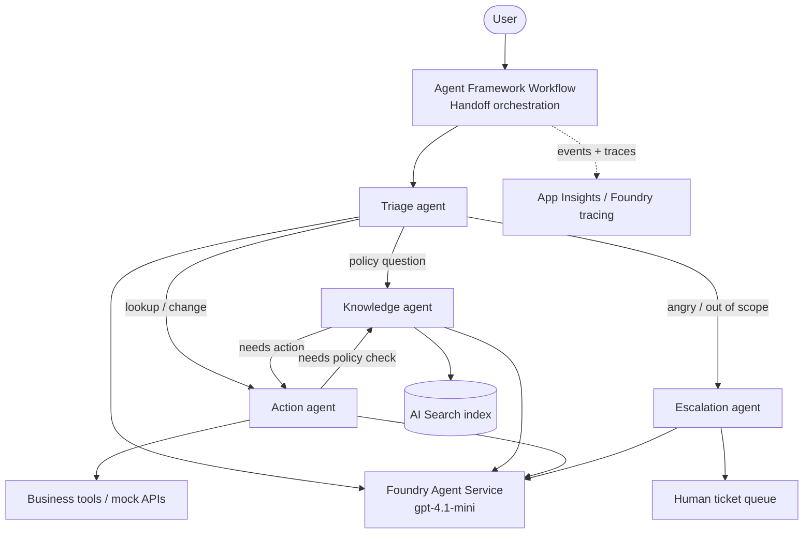

# Day 3: Multi-Agent Orchestration

> Use the separate starter kit shared for this event; the files and checkpoints below are not included in this documentation repository. Use its pinned SDK versions. Enforce a bounded hop count, timeout, and approval before write tools in application code, not only in prompts.

**Topic:** #2 Multi-agent orchestration

## Learning objectives
By the end of the day, participants can:
1. Explain **when** to use multiple agents (separation of concerns, tool overload, different permissions or models) and when **not** to (added latency, cost, complexity).
2. Compare the orchestration patterns: **sequential**, **concurrent**, **handoff**, **group chat**, and **magentic** (manager-led).
3. Build a **triage → specialist handoff** workflow with **Microsoft Agent Framework Workflows**.
4. Give each agent narrow instructions and a minimal tool set (least privilege).
5. Trace a multi-agent conversation end to end and debug routing mistakes.

## Agenda

| Time | Block | Content |
|---|---|---|
| 0:00–0:05 | Recap | Day 2 highlights; `git switch day-3-start` if needed |
| 0:05–0:20 | Concept | Single agent vs. multi-agent. Symptoms of an overloaded agent (wrong tool choice, long prompts, mixed permissions). |
| 0:20–0:35 | Concept | Agent Framework Workflows: executors, edges, agents-as-executors. The built-in patterns: sequential, concurrent, handoff, group chat, magentic. Agents-as-tools vs. workflows. Human-in-the-loop. |
| 0:35–0:55 | Live demo | Refactor the Day 2 agent into Triage + Knowledge + Action agents with a handoff workflow. Show the streamed workflow events and the trace. |
| 0:55–1:00 | Briefing | Challenge and milestones |
| 1:00–3:30 | **Hackathon** | M1–M4 + stretch goals (check-ins at 1:45 and 2:30; break around 2:10) |
| 3:30–3:50 | Demos | 3 volunteers × 5 min (show a routing trace) |
| 3:50–4:00 | Wrap | Recap, preview of Day 4; ask participants to prepare a 1-slide pitch for the showcase |

## Real-world use cases

| Use case | Agents | Business value |
|---|---|---|
| **Contact-center orchestration** (telco, retail) | Triage → billing, technical support, and retention specialists; human handoff | Each specialist is simpler, safer, and independently improvable. Better resolution rates. Only the billing agent can touch payment tools. |
| **Order-to-cash / claims processing** (insurance, wholesale) | Intake → validation → pricing/fraud check (concurrent) → approval agent → human approver | Automates multi-step back-office work with auditable steps. Concurrent checks reduce cycle time from days to minutes. |

## Hackathon challenge: "Agent Team"

### Problem statement
Your grounded agent now has too many tools and rules. Split it into a **team** orchestrated by a workflow:

| Agent | Responsibility | Tools |
|---|---|---|
| **Triage** | Understand intent, ask clarifying questions, route | None (routing only) |
| **Knowledge** | Answer policy questions with citations | `SearchPolicies` (Day 2) |
| **Action** | Look up and change records; ask for confirmation before writes | Day 1 business tools |
| **Escalation** *(optional at M4)* | Summarize the case for a human and create the ticket | `EscalateToHuman` / `OpenHrCase` / `FlagForReview` |

Requests that need **both** policy and action (e.g., "Am I allowed to return ORD-1001, and if so, start it") must flow through Knowledge and Action correctly.

### Architecture



### Azure services & SDKs

| Area | Service / package |
|---|---|
| Orchestration | `Microsoft.Agents.AI.Workflows` (handoff, sequential, concurrent builders) |
| Agents | `Microsoft.Agents.AI`, `Microsoft.Agents.AI.Foundry`, Foundry Agent Service |
| Retrieval | Azure AI Search (from Day 2) |
| Observability | OpenTelemetry → Application Insights; Foundry tracing |

### Milestones

| # | Milestone | Done when… | Suggested time |
|---|---|---|---|
| M1 | **Specialists.** Create the Knowledge and Action agents from your Day 2 agent. Each gets narrow instructions and **only** its own tools. | Each agent works alone when called directly from the console. | 35 min |
| M2 | **Sequential warm-up.** Build a 2-step sequential workflow (Knowledge → Action) for "check policy, then act". Stream workflow events to the console. | The console shows `[Knowledge] … → [Action] …` with outputs. | 30 min |
| M3 | **Handoff orchestration.** Add the Triage agent and replace the sequential flow with a handoff workflow (Triage ↔ Knowledge ↔ Action). | Five test prompts in `docs/day3-routing.md` route correctly (at least 4 of 5). | 50 min |
| M4 | **Escalate + trace.** Add the Escalation path. Find one complete multi-agent conversation in traces. | An angry or out-of-scope message ends with a ticket summary; a trace screenshot shows the handoffs. | 25 min |

### Stretch goals
- **Concurrent** pattern: for Order Processing, run inventory, credit, and fraud checks in parallel and aggregate the results; for HR, run policy + balance; for Support, run policy + order history.
- **Human-in-the-loop:** pause the workflow before a write action and require console approval.
- **Group chat / magentic:** add a "Reviewer" agent that critiques the Action agent's plan before it executes.
- **Agent as a tool:** expose the Knowledge agent as a function tool of the Action agent, and compare that with the handoff approach.
- Use a cheaper or faster model for Triage (if quota allows) and compare latency and cost.

## Starter code outline

```text
src/HackAgent.Core/
├─ Agents/
│  ├─ AgentCatalog.cs              # TODO: create Triage, Knowledge, Action, Escalation agents
│  └─ Instructions/<scenario>/
│     ├─ triage.md                  # starter routing rules (edit)
│     ├─ knowledge.md
│     ├─ action.md
│     └─ escalation.md
├─ Workflows/
│  ├─ SequentialWorkflow.cs        # M2 TODO
│  ├─ HandoffWorkflow.cs           # M3 TODO
│  └─ ConcurrentChecks.cs          # stretch
└─ Workflows/WorkflowConsoleRenderer.cs  # pretty-prints streamed events (provided)
docs/day3-routing.md               # 5 routing test prompts + expected agent path
```

Key code shape (illustrative; match the pinned `Microsoft.Agents.AI.Workflows` version):

```csharp
AIAgent triage    = await catalog.CreateTriageAsync();
AIAgent knowledge = await catalog.CreateKnowledgeAsync(searchTools);
AIAgent action    = await catalog.CreateActionAsync(businessTools);

// M2: sequential
Workflow seq = AgentWorkflowBuilder.BuildSequential(knowledge, action);

// M3: handoff – triage routes; specialists can hand back or across
Workflow handoff = AgentWorkflowBuilder.CreateHandoffBuilderWith(triage)
    .WithHandoffs(triage, [knowledge, action])
    .WithHandoffs([knowledge, action], triage)
    .Build();

await foreach (var evt in InProcessExecution.StreamAsync(handoff, messages))
    WorkflowConsoleRenderer.Render(evt);   // shows which agent is speaking
```

## Rubric (score each 1–5; max 20)

| Criterion | 1 – Beginning | 3 – Solid | 5 – Excellent |
|---|---|---|---|
| Functionality | Agents exist but aren't orchestrated | Handoff works for most routing prompts (≥4/5) | All routes, including combined policy + action and escalation; graceful clarification questions |
| Use of the day's tech | One big agent with a "persona switch" prompt | Workflow with specialists, least-privilege tools, streamed events | Plus a second pattern (concurrent / HITL / group chat) used for a real reason |
| Creativity | Default roles | Scenario-tailored roles and routing rules | Novel agent (reviewer, fraud checker, sentiment monitor) that adds clear value |
| Demo quality | Output only | Shows agents taking turns | Shows the trace, explains the routing decision, and discusses the trade-offs |

## Prerequisites
- Day 2 M3 complete, or `git switch day-3-start`
- Comfortable with `async`/`await` and `IAsyncEnumerable` (`await foreach`)

## Common pitfalls

| Pitfall | Fix |
|---|---|
| Triage answers the question itself instead of routing | Triage has no tools, and its instructions say: "Never answer directly; always hand off. Ask at most one clarifying question." |
| Ping-pong loops between agents | Give a clear "done" condition per agent, limit handoff targets, and set a max-turns limit on the workflow. |
| Specialists lose conversation context | Pass the full conversation into the workflow; don't start a fresh thread per agent call. |
| Every agent has every tool | Defeats the purpose. Least privilege is part of the rubric. |
| Latency and cost balloon | Keep instructions short; use top-5 retrieval; avoid unnecessary hops (Triage → Knowledge → Triage → Action). |
| Hard to see what happened | Use `WorkflowConsoleRenderer` and the traces; log the agent name on every event. |
