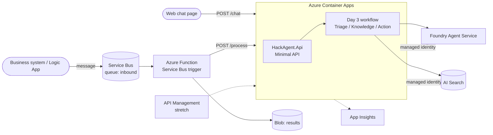

# Day 4: Ship It — Azure App Platform & Integration + Final Showcase

> **Blueprint:** deployment assets and helper scripts are proposed, not included. This is a synthetic-data pilot, not a production-ready service. Protect `/chat` and `/process` with authentication, authorize each session and operation, and use authenticated service-to-service calls; managed identity for downstream Azure services does not secure inbound HTTP endpoints.

**Topic:** #5 Azure App Platform and Integration Services

> **Modified day format:** 30 min learn · 1h45 hack · 1h45 showcase. This is needed so all 16 participants can demo. Participants should arrive with their Day 3 solution working (or switch to `day-4-start`).

## Learning objectives
By the end of the day, participants can:
1. Choose a hosting option for AI apps (**Container Apps** vs. App Service vs. Functions) and explain why.
2. Expose the agent team as an **HTTP API** (ASP.NET Core Minimal API) and deploy it to **Azure Container Apps** with `azd`, using a **managed identity** with no secrets.
3. Trigger the agent from **business events** using **Azure Service Bus** + **Azure Functions** (async processing).
4. Describe where **Logic Apps** (low-code connectors to Outlook, Teams, SAP, and so on), **API Management** (AI gateway: token limits, keys, logging), and **Event Grid** fit.
5. Present the solution as a business case.

## Agenda

| Time | Block | Content |
|---|---|---|
| 0:00–0:10 | Concept | Hosting AI agents: Container Apps (scale to zero, revisions), App Service, Functions. Managed identity everywhere. |
| 0:10–0:20 | Concept | Integration patterns: sync API vs. async queue, Service Bus + Functions, Logic Apps connectors, APIM as an AI gateway, Event Grid. |
| 0:20–0:30 | Live demo + briefing | `azd deploy api`, call `/chat`, drop a message on the queue and watch the Function process it. Challenge briefing. |
| 0:30–2:15 | **Hackathon** | M1–M3 required, M4 optional (check-in at 1:15; 5-min break around 1:20); demo prep from 2:00–2:15 |
| 2:15–3:35 | **Showcase** | 16 × 5 min (3 min demo + 2 min Q&A) |
| 3:35–3:45 | Judging | Judges deliberate; participants vote for People's Choice |
| 3:45–4:00 | Awards & close | Awards, feedback survey, **`azd down --purge`** reminder |

## Real-world use cases

| Use case | Integration | Business value |
|---|---|---|
| **Email-to-resolution automation** (customer service, AP invoices) | Logic Apps watches a shared mailbox → Service Bus → agent drafts a reply or creates a record → Teams approval | Turns unstructured inbound email into handled cases. Cuts response time from hours to minutes. Humans approve only exceptions. |
| **AI gateway for the enterprise** (any org with many AI apps) | APIM in front of agent and model endpoints: auth, per-team token quotas, semantic caching, logging | Central governance, chargeback, and cost control. Teams ship AI features without each reinventing security. |

## Hackathon challenge: "Production Pilot"

### Problem statement
Your agent team works on your laptop. Make it a **pilot service** that the business can use in two ways:
1. **Synchronously** from a web chat page or another app, via `POST /chat`.
2. **Asynchronously** from business systems: a new ticket, HR case, or purchase order arrives on a **Service Bus queue**. A **Function** sends it to the agent team, and the result is written to the `results` container in Blob Storage (or an outbound queue).

### Architecture



### Azure services & SDKs

| Area | Service / package |
|---|---|
| Hosting | Azure Container Apps (Consumption), Azure Container Registry, `azd deploy` |
| API | ASP.NET Core Minimal API, `Microsoft.Agents.AI.Hosting` (optional) |
| Messaging | Azure Service Bus (Basic), `Azure.Messaging.ServiceBus` |
| Event processing | Azure Functions (isolated worker, Flex Consumption), `Microsoft.Azure.Functions.Worker.Extensions.ServiceBus` |
| Storage | `Azure.Storage.Blobs` |
| Identity | User-assigned managed identity + RBAC (provisioned by Bicep) |
| Optional | Logic Apps (Consumption), API Management (Consumption/Basic v2), Event Grid |

### Milestones

| # | Milestone | Done when… | Suggested time |
|---|---|---|---|
| M1 | **API.** In `HackAgent.Api`, register the Day 3 workflow in DI and implement `POST /chat` (`{ sessionId, message }` → `{ reply, agentPath, citations }`). Run it locally and test with `requests.http`. | A local call returns a routed, cited answer. | 30 min |
| M2 | **Deploy.** Run `azd deploy api`, then confirm the app uses managed identity (no keys in config). Open `/` (the static chat page). | The public ACA URL answers chat requests. | 30 min |
| M3 | **Event-driven.** Implement the Service Bus–triggered Function: deserialize the message, call `/process`, and write the JSON result to the `results` blob container. Send test messages with `scripts/send-sample.ps1`. | 3 sample messages are processed and the results are visible in Storage. | 35 min |
| M4 *(optional)* | **Showcase polish.** Add a health endpoint, view App Insights live metrics, and prepare a 1-slide pitch. | Ready for a 3-minute demo. | 10 min+ |

### Stretch goals
- **Logic App:** an Outlook/Gmail "new email" trigger → send to Service Bus (no code).
- **API Management AI gateway:** import the ACA API, then add `rate-limit-by-key` and a subscription key requirement.
- **Teams notification** of escalated cases via a Logic App connector.
- **Dead-letter handling:** a poison message goes to the DLQ and an alert is raised.
- **Session state:** persist threads by `sessionId` (in-memory → Cosmos DB / Redis) so chats survive restarts.

## Starter code outline

```text
src/HackAgent.Api/
├─ Program.cs                   # TODO: DI for workflow + /chat, /process, /health endpoints
├─ Contracts/ChatRequest.cs     # provided
├─ wwwroot/index.html           # simple chat page (provided)
├─ requests.http                # local test calls
└─ Dockerfile                   # provided (multi-stage, non-root)
src/HackAgent.Functions/
├─ ProcessInbound.cs            # TODO: ServiceBusTrigger → HTTP call → blob output
└─ host.json / local.settings.json.example
scripts/send-sample.ps1         # sends 3 scenario messages to the queue
azure.yaml                      # services: api (containerapp), func (function)
```

Key code shape (illustrative):

```csharp
// HackAgent.Api/Program.cs
builder.Services.AddSingleton(sp => AgentTeam.CreateAsync(settings, new DefaultAzureCredential()).GetAwaiter().GetResult());
app.MapPost("/chat", async (ChatRequest req, AgentTeam team, CancellationToken ct) =>
    Results.Ok(await team.RunAsync(req.SessionId, req.Message, ct)));
app.MapGet("/health", () => Results.Ok("healthy"));

// HackAgent.Functions/ProcessInbound.cs
[Function(nameof(ProcessInbound))]
[BlobOutput("results/{MessageId}.json", Connection = "Storage")]
public async Task<string> Run(
    [ServiceBusTrigger("inbound", Connection = "ServiceBus")] ServiceBusReceivedMessage msg)
{
    var response = await _http.PostAsJsonAsync("/process", msg.Body.ToObjectFromJson<InboundCase>());
    response.EnsureSuccessStatusCode();
    return await response.Content.ReadAsStringAsync();
}
```

## Rubric (Day 4 milestones; score each 1–5)

These scores feed the "Use of the event's tech" criterion in the showcase. The **showcase rubric** that decides the awards is in [README.md](./README.md#final-showcase-format-and-scoring-day-4).

| Criterion | 1 – Beginning | 3 – Solid | 5 – Excellent |
|---|---|---|---|
| Functionality | Runs locally only | Deployed API works + queue messages processed | Plus resilient handling (retries, DLQ, health checks) |
| Use of the day's tech | Keys in config; manual deploy | `azd` deploy, managed identity, Service Bus + Function | Plus APIM / Logic Apps / observability used meaningfully |
| Creativity | Generic integration | Scenario-realistic event and output | Inventive integration (Teams approval, email flow, dashboard) |
| Demo quality | Disorganized; over time | Clear 3-minute story covering all four layers | Compelling business pitch, architecture explained, confident Q&A |

### Showcase demo checklist (for participants)
1. **Problem and persona** (20 s): who is the user and what is the pain?
2. **Live chat** (60 s): a policy question with a citation, then an action with a handoff.
3. **Event flow** (40 s): send a queue message and show the result in Storage.
4. **Architecture** (30 s): one diagram covering the agent team, RAG, and hosting.
5. **Next step** (10 s): what would make this production-ready?
6. **Backup:** have a 3-minute screen recording ready in case the live demo fails.

## Prerequisites
- Day 3 M3 complete, or `git switch day-4-start`
- ACA environment, ACR, Service Bus, and Function App provisioned (run `azd provision` again if setup skipped them)
- Docker is **not** required; `azd` builds remotely in ACR

## Common pitfalls

| Pitfall | Fix |
|---|---|
| Works locally, 403 in Azure | Your *user* had the roles; the app's **managed identity** needs *Azure AI User*, *Search Index Data Reader*, and the Service Bus/Storage roles. Bicep assigns these, but check `AZURE_CLIENT_ID` is set for the user-assigned identity. |
| Container starts then crashes | Missing environment variables in the Container App. Compare with `.env`, then run `azd env get-values` and `az containerapp logs show`. |
| First request is slow (cold start) | Scale to zero is expected. Set `minReplicas: 1` during the showcase only, then set it back. |
| Function never fires | Check that the queue name and the `ServiceBus__fullyQualifiedNamespace` setting match (identity-based connection) and that the function app identity has *Azure Service Bus Data Receiver*. |
| Messages retried endlessly | Exceptions cause redelivery. After max delivery count, a message goes to the DLQ, so make the processing idempotent. |
| `azd deploy` fails building the image | Check the Dockerfile path in `azure.yaml`; check the .NET SDK image tag matches `TargetFramework`. |
| Forgot to clean up | Confirm your workshop environment, run `azd down --purge` at the end of the day, and verify that no workshop resources remain billable. |
