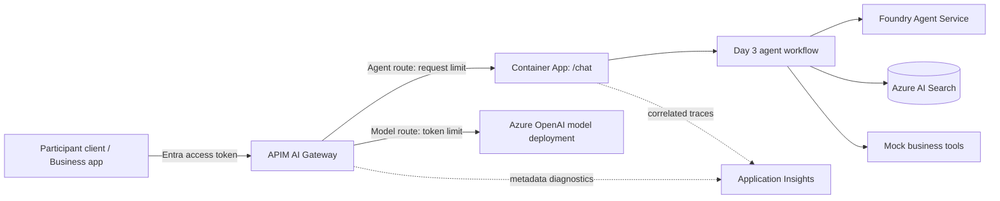

# Day 4: Ship It Through an AI Gateway + Final Showcase

**Topic:** #5 Azure App Platform and Integration Services, using **Azure API Management (APIM) AI Gateway** as the integration layer.

> This documentation repository does not include application projects or deployment templates. Use the separate starter kit and tested versions shared for the event. Code and policy fragments are illustrative. Use synthetic data only.

**Day format:** 30 min learning, 105 min individual build, 105 min showcase. Arrive with Day 3 working, or save your work and use `day-4-start` when available.

## Learning objectives

1. Deploy your existing agent team as an ASP.NET Core HTTP API on Azure Container Apps.
2. Publish a single governed entry point through APIM AI Gateway.
3. Validate Microsoft Entra ID tokens, authorize sessions, and apply per-caller request limits.
4. Proxy a model API through the same gateway and demonstrate a model-token limit.
5. Explain the difference between governing an agent API and governing its underlying model calls.

## Agenda

| Time | Block | Content |
|---|---|---|
| 0:00-0:10 | Concept | Container Apps hosting; managed identity; AI Gateway vs. application workflow orchestration |
| 0:10-0:20 | Concept | Gateway routes, Entra authentication, request throttling, model-token limits, safe diagnostics |
| 0:20-0:30 | Demo and briefing | Call the agent through the gateway, reject an unauthenticated caller, and show a token-limited model request |
| 0:30-0:50 | Build M1 | Expose your Day 3 agent team as `/chat` |
| 0:50-1:10 | Build M2 | Deploy and test gateway-to-backend authentication |
| 1:10-1:45 | Build M3 | Publish agent and model routes; test gateway policies |
| 1:45-1:50 | Break | Step away from the screen |
| 1:50-2:00 | Buffer / stretch | Troubleshooting, diagnostics, or optional improvements |
| 2:00-2:15 | Demo preparation | Capture evidence and rehearse your 3-minute story |
| 2:15-3:35 | Showcase | 16 demos, each 3 min plus 2 min Q&A |
| 3:35-3:45 | Results | Score aggregation and People's Choice voting |
| 3:45-4:00 | Close | Awards, feedback, and workshop resource cleanup |

## Real-world use cases

| Use case | Integration through AI Gateway | Business value |
|---|---|---|
| Customer support copilot for multiple channels | Web chat and CRM call one governed agent endpoint; each authorized caller has a request allowance | Consistent access control, traceable requests, and protection against accidental bursts |
| HR or procurement AI platform | An employee portal calls the agent route; approved applications call a separate model route with token controls | Reusable integration, identity-based governance, and visibility into direct model consumption |

## Hackathon challenge: "Governed AI Pilot"

### Problem statement

Your agent team works locally. Make it accessible through **one APIM gateway** with two routes:

- **Agent route:** `POST /agents/chat` forwards to the Container App's `/chat` endpoint. It returns `{ reply, agentPath, citations, requestId }`.
- **Model route:** an imported Azure OpenAI Chat Completions API forwards to your `gpt-4.1-mini` deployment. It is used for a small, read-only summarization test with token governance.

The normal business flow remains the Day 3 agent team. **No Service Bus, Function App, queue, or background-processing exercise is required.** This is synchronous API integration; a gateway is not a replacement for durable messaging.

**Important boundary:** a custom `/chat` response is not a model Chat Completions response. Apply request limits to the agent route and `llm-token-limit` to the supported model route only. Foundry Agent Service's internal model calls do **not** automatically pass through APIM. The model-route test demonstrates gateway token governance, not a token cap on the hosted agents.

### Architecture



### Azure services and SDKs

| Area | Service / package |
|---|---|
| Integration | Azure API Management **Developer tier** for this non-production workshop; supports the required request and LLM-token policies |
| Hosting | Container Apps Consumption and Azure Container Registry |
| Application | ASP.NET Core Minimal API; Day 3 `Microsoft.Agents.AI` and `Microsoft.Agents.AI.Workflows` |
| Authentication | Microsoft Entra ID; `Microsoft.Identity.Web` in the API; APIM `validate-azure-ad-token` and `authentication-managed-identity` |
| Model route | Import Azure OpenAI API; APIM managed identity with `Cognitive Services OpenAI User` at the model resource |
| Observability | APIM diagnostics and Application Insights; metadata only, without authorization headers or prompt bodies |
| Provisioning | Starter-kit Bicep and `azd`; no APIM runtime SDK required for policy configuration |

Use the pre-provisioned Developer instance for the exercise; initial provisioning may take substantially longer than the build block. Developer has no production SLA. Do not substitute Consumption without checking policy support: the required `llm-token-limit` policy is not listed for that tier.

### Milestones

| # | Build | Acceptance evidence | Time |
|---|---|---|---|
| M1 | **API.** Implement `/chat`, validate input, bind sessions to the authenticated user, and reuse the Day 3 workflow. Keep `/health` separate. | A local authenticated request returns a cited answer and agent path; missing/invalid input returns a clear 400. | 20 min |
| M2 | **Deploy.** Run `azd deploy api`. Protect the backend with Entra authentication and authorize only the gateway application's identity for remote `/chat` calls. Preserve validated caller identity across the hop. | Gateway identity can invoke the backend; an unauthenticated direct backend call is rejected. | 20 min |
| M3 | **Gateway.** Import the agent API and Azure OpenAI API, apply the supplied authentication/policy scaffolds, and test both routes. | Valid agent call succeeds; invalid token returns 401; unapproved caller returns 403; a burst exceeds the configured agent request rate and returns 429; an oversized model prompt exceeds its token rate and returns 429. Capture request IDs and redacted diagnostics. | 35 min |

The remaining 30 minutes are a 5-minute break, 10-minute buffer, and 15-minute demo preparation. Authentication and API-import scaffolds must come from the separate starter kit; building tenant registrations from scratch is outside this short exercise.

### Policy settings and test cases

| Route | Setting | Test |
|---|---|---|
| Both | Validate expected tenant, token audience, and required scopes/roles | Missing/expired token: 401; authenticated but unauthorized caller: 403 |
| Agent | `rate-limit-by-key`: 5 requests per 60 seconds, keyed by validated caller identity | Send a short burst; confirm 429 and `Retry-After`. Keep prompts small; stop on throttling |
| Model | `llm-token-limit`: 1,000 tokens/minute with prompt estimation, keyed by validated caller identity | In a fresh window send a synthetic prompt clearly above 1,000 tokens, allowing for the pinned model tokenizer; confirm 429 |
| Agent backend | Gateway managed identity plus trusted original caller context | A direct unauthorized request fails; a spoofed caller header is overwritten or rejected |
| Diagnostics | Request ID, route, status, latency; no prompt content or secrets | Correlate a successful call and a rejected call without exposing tokens |

Illustrative fragments belong in **different API policies**, after token validation and role/scope checks. The authentication scaffold sets `callerId` from validated `tid` + `oid` claims, never from a user-supplied header. APIM rate limits are distributed controls, not precise financial caps.

```xml
<!-- Agent API inbound fragment -->
<rate-limit-by-key calls="5" renewal-period="60"
    counter-key='@("agent:" + (string)context.Variables["callerId"])' />
```

```xml
<!-- Model API inbound fragment; not the custom agent API -->
<llm-token-limit
    counter-key='@("model:" + (string)context.Variables["callerId"])'
    tokens-per-minute="1000"
    estimate-prompt-tokens="true" />
```

Gateway-to-backend identity is distinct from the original user. The supplied backend authentication scaffold must validate the gateway token and trust caller context only on that authenticated hop. Never authorize a session based solely on a `sessionId` or an unvalidated identity header.

### Stretch goals

- Configure a daily model-token quota and explain its 403 response versus the rate limit's 429.
- Add a second approved model backend and a circuit breaker. Do not blindly retry write actions.
- Add a dashboard of route latency, rejected calls, and direct-model token usage.
- Let a Logic App call the authenticated gateway agent route; keep connectors optional.
- Explore semantic caching for read-only, non-personalized model requests only. Do not cache actions or cross-user HR/customer responses.

## Starter-code outline

These are the expected assets in the separate starter kit, not files in this documentation repository.

```text
src/HackAgent.Api/
  Program.cs                    # authenticated /chat and /health
  Contracts/ChatRequest.cs       # sessionId, message
  Contracts/ChatResponse.cs      # reply, agentPath, citations, requestId
  Security/CallerContext.cs     # validates gateway identity and trusted user context
  Dockerfile                    # multi-stage, non-root
gateway/
  agent-api.openapi.json        # gateway /agents/chat -> backend /chat
  policies/agent-inbound.xml    # token validation, roles, request limit, backend identity
  policies/model-inbound.xml    # token validation, roles, token limit, model identity
scripts/
  test-gateway.ps1              # auth failures, happy path, request/token throttling
  summarize-sample.ps1          # synthetic read-only model-route example
infra/
  gateway.bicep                 # APIM Developer, identities, diagnostics
  auth.bicep                    # associated authentication configuration
azure.yaml                      # service: api (containerapp)
```

Tenant application registrations, consent, and API app roles are prerequisites configured by the starter kit's documented authentication setup, not assumed to appear automatically from Azure RBAC assignments.

## Rubric (score each 1-5)

Use this as a readiness check, not an additional daily progress bonus. See the [showcase scoring](README.md#assessment-and-showcase).

| Criterion | 1 - Beginning | 3 - Solid | 5 - Excellent |
|---|---|---|---|
| Functionality | Local API only | Agent works through gateway with citations | Both routes pass success, authentication, authorization, and throttle tests |
| Use of the day's technology | Gateway is bypassed | APIM is the required entry point; request and model-token policies work | Plus backend identity enforcement and correlated, redacted diagnostics |
| Creativity | Unchanged sample | Scenario-specific client or summarization request | Useful governed integration or safe resilience improvement |
| Demo quality | Output without context | Clear business flow and one rejected request | Explains both routes and honestly distinguishes agent requests from model-token accounting |

## Showcase demo checklist

1. **Problem and user (20 s).**
2. **Agent through gateway (60 s):** grounded answer, citation, specialist handoff, and approved mock action.
3. **Gateway controls (40 s):** show a rejected request and token-limit evidence from the direct model route.
4. **Architecture (30 s):** explain the two gateway routes and hosted-agent boundary.
5. **Next improvement (10 s).** Keep a backup recording and sanitized evidence ready.

## Prerequisites

- Day 3 M3 complete, or a published `day-4-start` checkpoint.
- Container Apps, ACR, APIM Developer, identities, model access, and diagnostics already provisioned.
- The event's Entra app registrations, roles/scopes, consent, and test access-token instructions.
- A working gateway URL and a passed [Day 4 readiness check](setup.md#day-4-gateway-readiness).
- No local Docker requirement when using the starter kit's remote ACR build.

## Common pitfalls

| Symptom | Action |
|---|---|
| APIM is still deploying | Complete provisioning before the session; do not spend the build block waiting for a new instance |
| Gateway 401/403 | Check tenant, audience, expiry, scopes/roles, and backend managed identity separately |
| Token policy fails on `/chat` | It expects a supported model schema; use request throttling for the agent route |
| Agent tokens are absent from model-route usage | Hosted Agent Service inference is not on that route; do not claim full agent cost enforcement |
| 429 from the backend rather than the gateway | Correlate diagnostics; model quota and APIM policy limits are separate controls |
| Backend bypass works or caller identity can be spoofed | Enforce gateway identity at the API, overwrite incoming caller headers, and validate session ownership |
| Policy rejects the configured tier | Use the tested Developer tier and check the current policy support matrix |
| Container cold start delays demo | Warm it before presenting, or temporarily use one minimum replica; restore scale-to-zero afterward |
| Gateway/model resource keeps charging | Verify teardown of the APIM instance and all workshop resources, not just the Container App |

## References

- [Azure API Management AI Gateway](https://learn.microsoft.com/en-us/azure/api-management/genai-gateway-capabilities)
- [LLM token limits and supported model schemas](https://learn.microsoft.com/en-us/azure/api-management/llm-token-limit-policy)
- [Per-key request limits](https://learn.microsoft.com/en-us/azure/api-management/rate-limit-by-key-policy)
- [Validate Entra tokens](https://learn.microsoft.com/en-us/azure/api-management/validate-azure-ad-token-policy)
- [Managed identity authentication](https://learn.microsoft.com/en-us/azure/api-management/authentication-managed-identity-policy)
